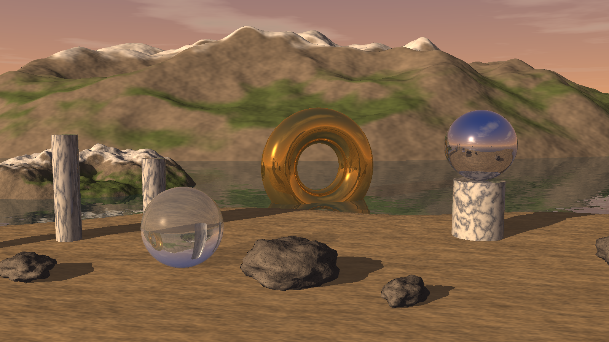
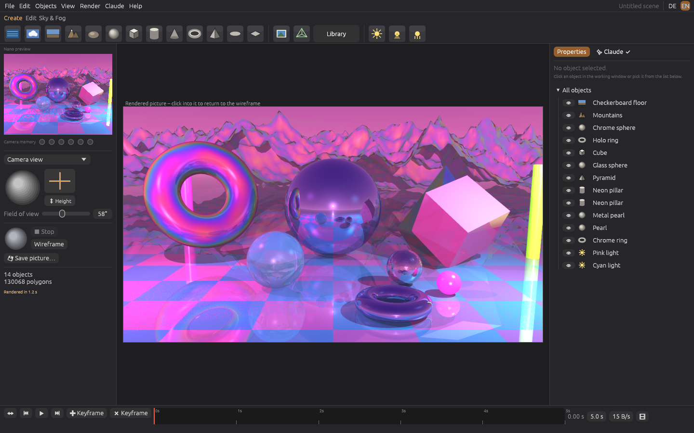
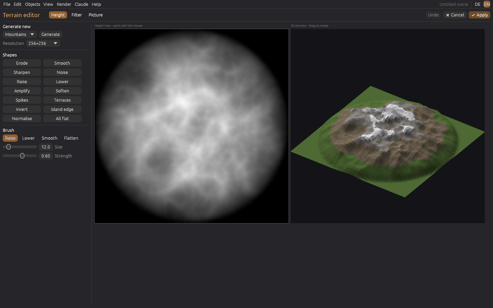
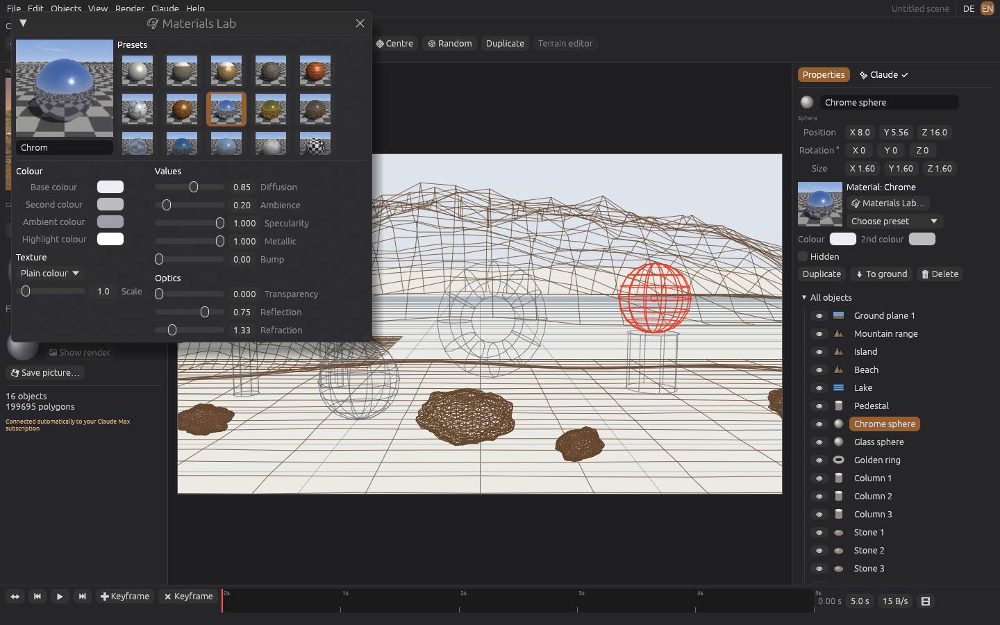
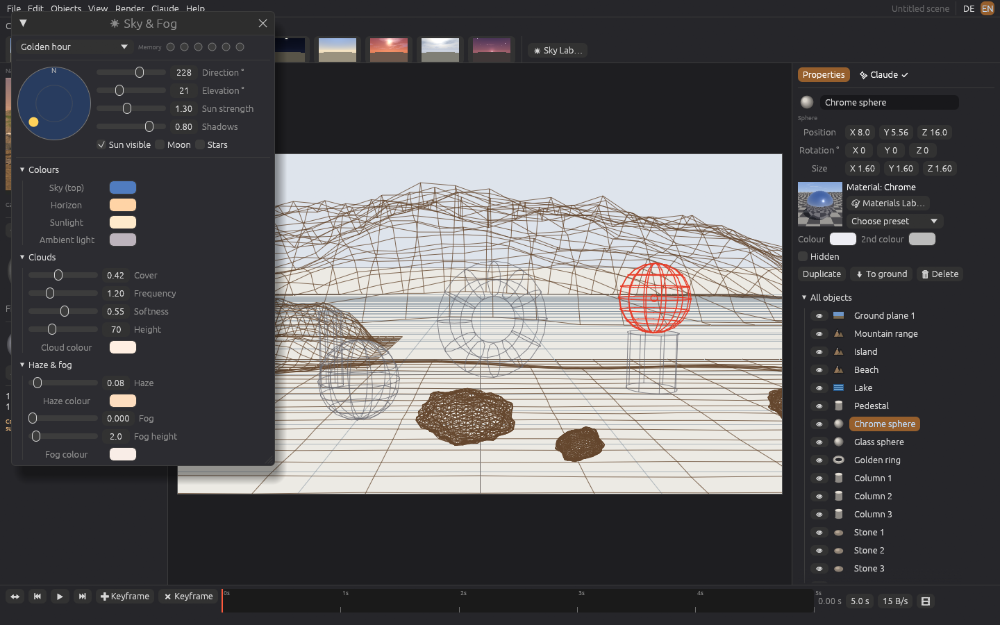
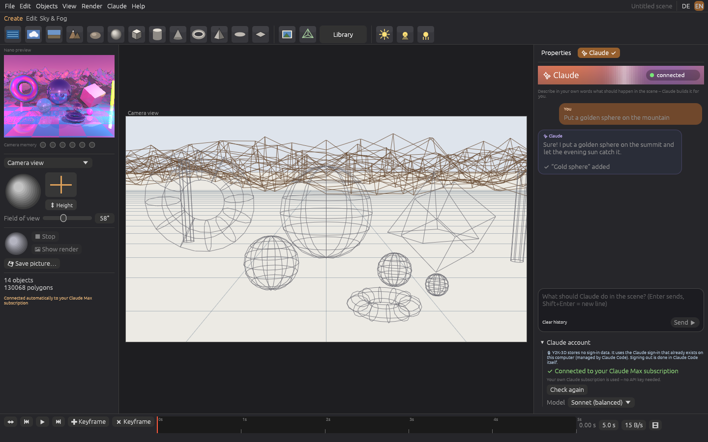
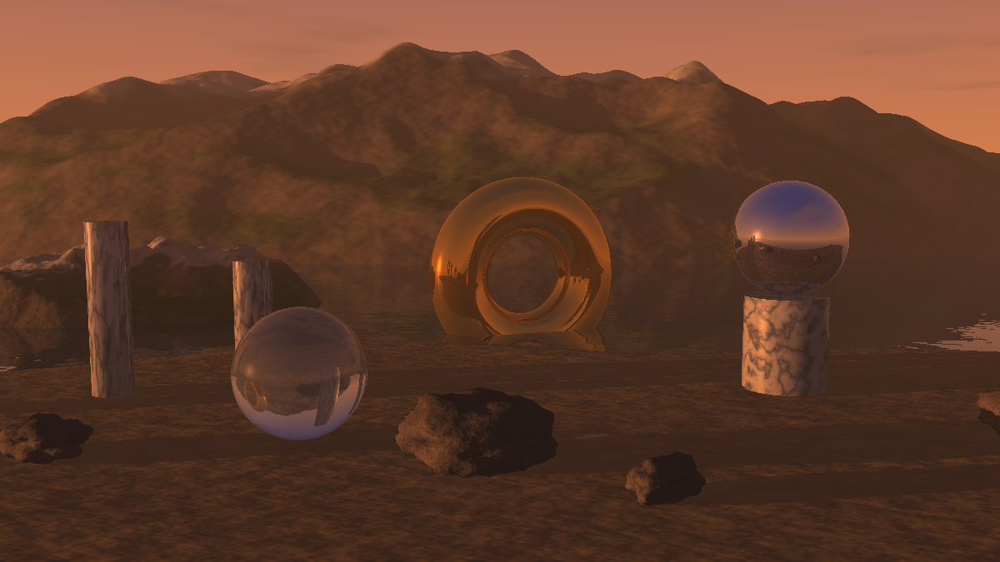
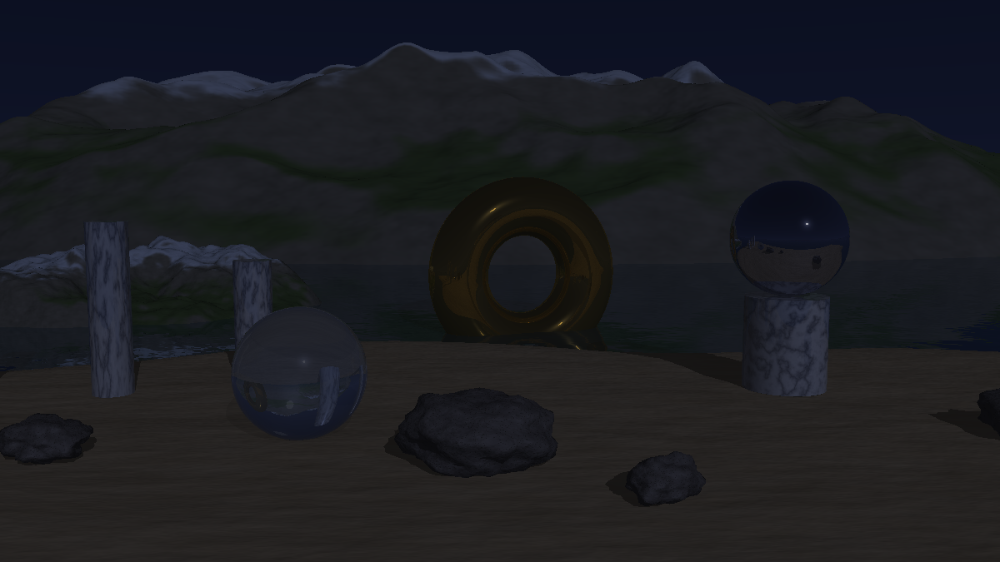
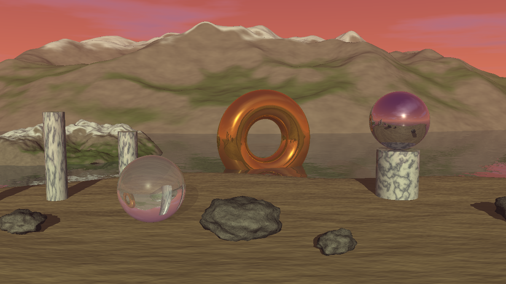

<div align="center">

<a href="https://github.com/Bratwurstexe/Y2K-3D/releases/latest/download/Y2K-3D.exe"></a>

<sub>Direct download of the latest portable version – no installation, just double-click. &nbsp;·&nbsp; <a href="https://github.com/Bratwurstexe/Y2K-3D/releases/latest">all release files</a></sub>

# Y2K-3D

**A native Windows 3D landscape studio: build worlds from terrains, skies, water and objects, then ray-trace them into pictures and animations.**

Inspired by the classic landscape renderers of the late 1990s, rebuilt from scratch for Windows 11, with an optional AI assistant you can talk to.

[](https://github.com/Bratwurstexe/Y2K-3D/actions/workflows/build.yml)


[](https://github.com/Bratwurstexe/Y2K-3D/releases)
[](https://github.com/Bratwurstexe/Y2K-3D/releases/latest)
[](LICENSE)
-success)

**[Download Y2K-3D.exe](https://github.com/Bratwurstexe/Y2K-3D/releases/latest/download/Y2K-3D.exe)** &nbsp;·&nbsp;  downloads so far



*The demo scene Y2K-3D opens with, rendered in about a second on a desktop CPU.*

</div>

---

## Contents

- [Highlights](#highlights)
- [Screenshots](#screenshots)
- [System requirements](#system-requirements)
- [Download & run](#download--run)
- [Quick start](#quick-start)
- [The Claude assistant](#the-claude-assistant)
- [Controls](#controls)
- [Files & libraries](#files--libraries)
- [Building from source](#building-from-source)
- [Project structure](#project-structure)
- [Roadmap](#roadmap)
- [Contributing](#contributing)
- [License](#license)

## Highlights

| | |
|---|---|
| **Terrain editor** | Fractal mountains, hills, ridges, canyons, dunes and craters; hydraulic & thermal erosion; smoothing, terraces, spikes, island edges; a filter curve; a paint brush; height maps from any picture (including old 8-bit palette TIFFs). Live 3D preview. |
| **Sky & Fog** | Sun or moon position on a draggable ball, sky / horizon / sunlight colours, procedural clouds (cover, frequency, softness, height), atmospheric haze, height fog, stars. Ten presets from clear noon to moonlit night, plus memory dots. |
| **Materials Lab** | Diffusion, ambience, specularity, metallic tint, bump, transparency, reflection and refraction; procedural textures (noise, marble, wood, granite, checker, stripes, height-based landscape, clouds) or picture textures. Twenty presets with live sphere previews. |
| **Ray tracer** | Multi-threaded and progressive (coarse blocks first, then fine detail, then adaptive anti-aliasing). Shadows, reflections, refraction, Fresnel water, spot / point / parallel lights. Fast height-field traversal and BVH-accelerated meshes. |
| **Objects** | Sphere, cube, cylinder, cone, torus, pyramid, disk, square, procedural stones, infinite ground / water / cloud planes, picture objects with alpha cut-outs, imported OBJ and DXF models. |
| **Animation** | Keyframes for camera, objects and sun on a timeline, smooth spline motion, wireframe playback, export as a PNG frame sequence. |
| **Claude assistant** | Describe what you want ("an island at sunset with fog over the water") and Claude builds it in the scene, using your own Claude subscription through Claude Code. No API key, nothing stored. |
| **Classic workflow** | Wireframe working window with camera and orthographic views, nano preview, camera memory dots, trackball and camera cross, create / edit / sky palettes, undo / redo. |
| **English & German** | Switch the whole interface with one click (`DE \| EN`, top right). |
| **Portable** | One `.exe`, no installer, no admin rights, no runtime to install. Settings live in a `Daten` folder next to the program. |

## Screenshots

<table>
<tr>
<td width="50%"><br><sub><b>Main window</b> – palettes on top, camera controls and nano preview on the left, properties on the right.</sub></td>
<td width="50%"><br><sub><b>Terrain editor</b> – generate, erode and paint height maps with a live 3D preview.</sub></td>
</tr>
<tr>
<td width="50%"><br><sub><b>Materials Lab</b> – presets, colours, values, optics and textures.</sub></td>
<td width="50%"><br><sub><b>Sky &amp; Fog</b> – drag the sun, set clouds, haze and fog.</sub></td>
</tr>
<tr>
<td width="50%"><br><sub><b>Claude assistant</b> – type a wish, press Enter, watch the scene change.</sub></td>
<td width="50%"><br><sub><b>Sunset</b> – the same scene with a different sky preset.</sub></td>
</tr>
<tr>
<td width="50%"><br><sub><b>Moonlit night</b></sub></td>
<td width="50%"><br><sub><b>Alien planet</b></sub></td>
</tr>
</table>

## System requirements

| | Minimum | Recommended |
|---|---|---|
| **Operating system** | Windows 10 (64-bit, version 1809 or newer) | Windows 11 (64-bit) |
| **Processor** | Any 64-bit x86 CPU (2 cores) | 6+ cores – the ray tracer uses every core |
| **Memory** | 4 GB RAM | 8 GB RAM or more |
| **Graphics** | Any GPU / driver with OpenGL 2.0 (integrated graphics are fine) | Up-to-date graphics driver |
| **Display** | 1280 × 720 | 1920 × 1080 or larger |
| **Disk space** | ~15 MB (plus your scenes and pictures) | |
| **Installation** | None – it's a single portable `.exe` | |
| **For the assistant (optional)** | [Claude Code](https://claude.com/claude-code) installed and signed in with a Claude Pro or Max subscription | |

No Visual C++ redistributable, .NET or other runtime is needed: the program only uses libraries that ship with Windows.

## Download & run

1. Download [**Y2K-3D.exe**](https://github.com/Bratwurstexe/Y2K-3D/releases/latest/download/Y2K-3D.exe) (always the latest version; all files are on the [Releases](https://github.com/Bratwurstexe/Y2K-3D/releases) page).
2. Put it in any folder (a USB stick works too) and double-click it.
3. If Windows SmartScreen warns about an unknown publisher, click **More info**, then **Run anyway** (the program isn't code-signed).

Y2K-3D opens in English with a rendered demo scene. Click into the picture to get back to the wireframe.

## Quick start

1. **Create**: pick an object from the *Create* palette (terrain, water, clouds, stones, primitives, lights). It appears in front of the camera.
2. **Arrange**: click an object to select it, drag it to move it (hold **Shift** to move up / down). Fine-tune position, rotation and size on the right.
3. **Look**: drag empty space (or use the right mouse button) to orbit, the mouse wheel to move forward / back, the middle button to pan. Switch to top / front / side views in the drop-down on the left.
4. **Style it**: double-click an object for the *Materials Lab* (or the *Terrain editor* for terrains), open *Sky & Fog* for the atmosphere.
5. **Render**: click the big ball on the left (or press **Ctrl+R**). Save the picture with **Save picture…**.
6. **Animate** (optional): click a time on the timeline, set up the scene, press **Keyframe** (the button with the plus sign); repeat, then **Play** to preview or the film button to render PNG frames.

## The Claude assistant

Open the **Claude** tab on the right and simply write what you want, for example:

- *"Make an island in the sea at sunset"*
- *"Put a golden sphere on the mountain"*
- *"Morning mist over the lake, camera a bit lower"*

Press **Enter** to send (Shift+Enter for a new line). Claude reads a short summary of your scene and answers with concrete changes (add / modify / delete objects, reshape terrains, change the sky, move the camera, set keyframes, start a render), which Y2K-3D applies right away. Every change can be undone with **Ctrl+Z**.

**How it connects:** Y2K-3D runs the locally installed [Claude Code](https://claude.com/claude-code) in the background (`claude -p`, without tools, MCP servers or saved sessions) and uses the sign-in that already exists on your computer, i.e. your own Claude Pro / Max subscription. It connects automatically on start.

- Y2K-3D **stores no sign-in data, tokens or API keys**. Signing out is done in Claude Code itself.
- Not signed in yet? The Claude tab has a **Sign in with Claude account** button that opens Claude Code's own sign-in.
- Usage counts towards your normal Claude subscription limits.

## Controls

| Action | Mouse / key |
|---|---|
| Select object | Left-click |
| Move selected object | Drag it (Shift: up / down) |
| Orbit camera | Drag empty space or right mouse button |
| Pan camera | Middle mouse button |
| Forward / back | Mouse wheel |
| Materials Lab / Terrain editor | Double-click the object |
| Render / stop | Ctrl+R / Esc |
| Undo / redo | Ctrl+Z / Ctrl+Y |
| Duplicate / delete | Ctrl+D / Del |
| Nudge selected object | Arrow keys, Page Up / Page Down (Shift = bigger steps) |
| Next object | Tab |
| Open / save scene | Ctrl+O / Ctrl+S |

## Files & libraries

| What | Format |
|---|---|
| Scenes | `.l3d` (JSON, includes terrains and imported meshes) |
| Rendered pictures | PNG, JPEG, BMP |
| Animations | PNG frame sequence (`bild_0001.png`, …) |
| 3D model import | Wavefront OBJ, AutoCAD DXF (3DFACE; Mac/Windows/Unix line endings) |
| Pictures (terrain maps, textures, picture objects) | TIFF (incl. 8-bit palette TIFFs), PNG, JPEG, BMP |

**Old CD libraries:** if `Y2K-3D.exe` sits inside (or below) a folder that contains classic library folders such as `Terrain  Maps`, `Picture Textures`, `Picture Objects` or `OBJ Models`, they show up automatically in the terrain editor, the Materials Lab and the import dialogs. You can also point the `Y2K3D_LIBRARY` environment variable at such a folder. Proprietary scene / library container formats of old commercial programs can't be opened.

**Command line:**

```text
Y2K-3D.exe --render <scene.l3d | demo> <out.png> [--size 1920x1080] [--sky "<preset>"]
Y2K-3D.exe --screenshot <out.png>      # start, draw ~120 frames, save the window, quit
```

## Building from source

**Requirements**

- Windows 10 / 11, 64-bit
- [Rust](https://rustup.rs) (stable). The repository pins the `stable-x86_64-pc-windows-msvc` toolchain in `rust-toolchain.toml`; rustup installs it automatically.
- [Visual Studio 2022 Build Tools](https://visualstudio.microsoft.com/visual-cpp-build-tools/) with the **Desktop development with C++** workload (MSVC linker and Windows SDK)

**Build**

```powershell
git clone https://github.com/Bratwurstexe/Y2K-3D.git
cd Y2K-3D
cargo build --release
.\target\release\Y2K-3D.exe
```

The C runtime is linked statically (`.cargo/config.toml`), so the resulting `.exe` runs on any 64-bit Windows 10/11 machine without installing anything.

**Tests**

```powershell
cargo test --release
```

## Project structure

```text
src/
├── main.rs       entry point, command line, window setup
├── app.rs        main window: menus, palettes, working window, properties, animation, Claude panel
├── labs.rs       Materials Lab, Sky & Fog lab, Terrain editor
├── render.rs     ray tracer: views, intersections, sky & atmosphere, shading, progressive renderer
├── scene.rs      scene model: objects, materials, sky, camera, keyframes, presets, demo scene
├── terrain.rs    height maps: fractals, erosion, filters, brush
├── mesh.rs       triangle meshes: OBJ / DXF import, stones, BVH
├── wire.rs       wireframe outlines and projection
├── noise.rs      gradient noise and fractal sums
├── picture.rs    picture loading incl. palette TIFFs
├── claude.rs     Claude Code connection and scene actions
├── i18n.rs       English / German texts
├── icons.rs      hand-drawn palette icons
└── settings.rs   portable settings next to the program
```

Built with [eframe / egui](https://github.com/emilk/egui), [glam](https://github.com/bitshifter/glam-rs), [rayon](https://github.com/rayon-rs/rayon), [image](https://github.com/image-rs/image), [rfd](https://github.com/PolyMeilex/rfd) and [serde](https://serde.rs).

## Roadmap

- [ ] Boolean (CSG) objects: cut one object out of another
- [ ] Volume materials (smoke, fog bodies)
- [ ] Object groups and linking
- [ ] Video export (MP4) in addition to frame sequences
- [ ] Depth of field and soft shadows
- [ ] More languages

Ideas and pull requests are welcome.

## Contributing

1. Fork the repository and create a branch.
2. Keep the code formatted (`cargo fmt`) and the build warning-free (`cargo build`).
3. New UI text is written in German in the source and wrapped in `crate::i18n::tr("…")` or `crate::trf!("…", …)`; add the English text to the table in `src/i18n.rs`.
4. Open a pull request describing what changed and, for visual changes, attach a screenshot.

Bug reports and feature requests: please use [Issues](https://github.com/Bratwurstexe/Y2K-3D/issues).

## License

Released under the [MIT License](LICENSE).

Y2K-3D is an independent project and is not affiliated with or endorsed by any maker of earlier landscape software. "Claude" and "Claude Code" are products of Anthropic; using the assistant requires your own Claude account.
